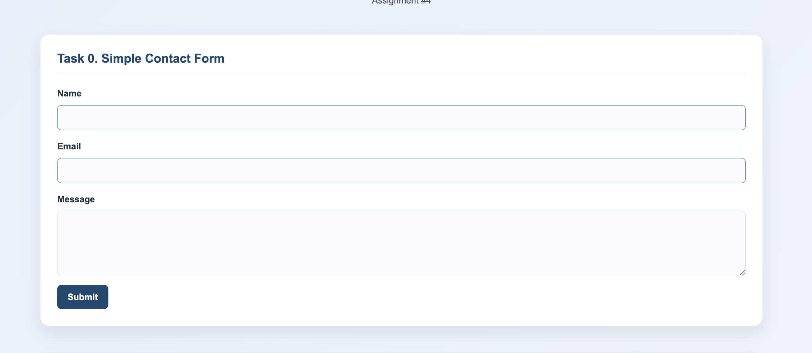
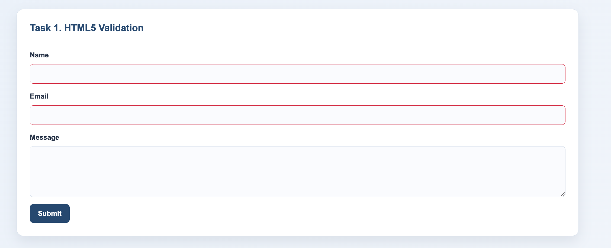
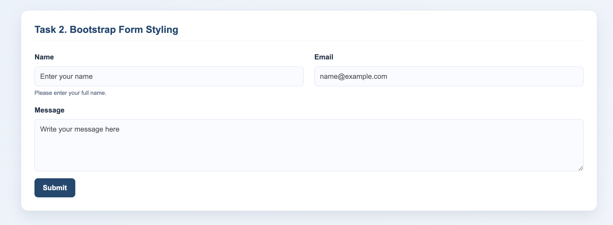
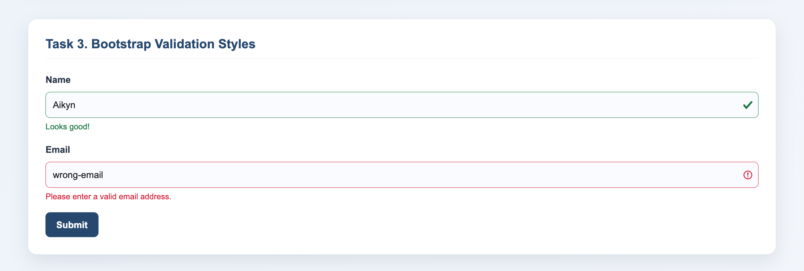
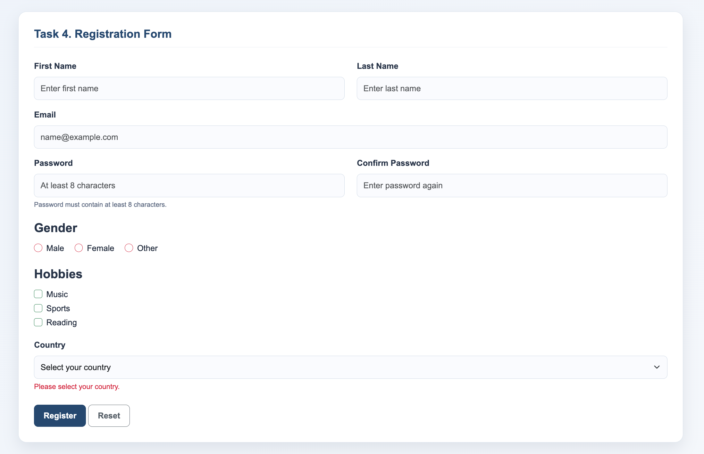

# Assignment #4 — Forms and Validation

**Name:** Aikyn Sabit  
**Group:** IT-2504

## Task 0 — Simple Contact Form

Created a simple contact form with Name, Email, Message and Submit button. Added labels for all fields.

## Task 1 — HTML5 Validation

Added HTML5 validation attributes such as required, type="email", minlength and maxlength. Tested the validation in the browser.

## Task 2 — Bootstrap Form Styling

Styled the contact form using Bootstrap classes. Used the grid system, placeholders and helper text to make the form clear and responsive.

## Task 3 — Bootstrap Validation Styles

Used the is-valid and is-invalid classes to show successful and invalid input states. Added feedback messages below the fields.

## Task 4 — Registration Form

Created a registration form with First Name, Last Name, Email, Password, Confirm Password, Gender, Hobbies and Country fields. Added Submit and Reset buttons, Bootstrap Grid and HTML5 validation.

## Summary

During this assignment, I practiced creating HTML forms, using HTML5 validation and styling forms with Bootstrap. I also created a registration form and improved the design with CSS.

## Technologies Used

 HTML5
 CSS3
 Bootstrap 5

## GitHub

(https://github.com/aikynsabit077/assignmentWEB4)

## Link to Website

(https://aikynsabit077.github.io/assignmentWEB4/)
